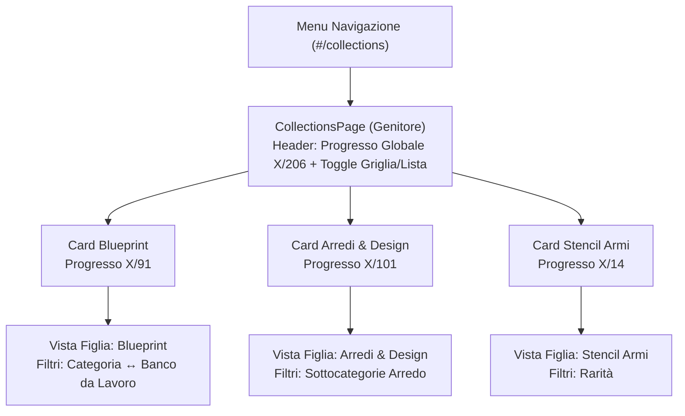

# Specifica Tecnica — Collezioni In-Raid (#145, #91)

*Data: 14 Novembre 2026*  
*Milestone: 0.6.0 ("Archivio del Rifugio")*  
*Issue di riferimento: [#145](https://github.com/ieeah/arc-benches/issues/145), [#91](https://github.com/ieeah/arc-benches/issues/91), [#164](https://github.com/ieeah/arc-benches/issues/164)*

---

## 1. Obiettivo e Perimetro

Evolvere l'attuale pagina singola `BlueprintsPage` nella sezione unificata **«Collezioni»** del rifugio (`#/collections`), dedicata al tracciamento di tutti e soli i **collezionabili trovati in raid** (progressione gameplay, arredo rifugio e personalizzazione armi, con esclusione dei cosmetici secondari/DLC rimandati alla sezione Guardaroba #131):

1. **Progetti & Blueprint** (91 oggetti): schemi di fabbricazione per armi, modifiche, gadget, innesti e materiali.
2. **Design & Arredi Rifugio** (101 oggetti): progetti cartacei trovati nei raid che sbloccano gli arredi dell'Outpost e del Rifugio.
3. **Stencil Armi** (14 oggetti): pattern e verniciature sbloccabili per le armi da fuoco.

Totale: **206 collezionabili di gioco**.

---

## 2. Architettura UX: Pagina Genitore e Viste Figlie



### 2.1. Pagina Genitore (`#/collections`)

* **Header Sticky (`PageLayout`)**:
  - Titolo: *Collezioni* con icona tematica (`Boxes` / `Archive`).
  - **Barra di progresso globale**: percentuale e contatore combinato (`X / 206 • Y%`).
  - **Toggle Vista Griglia / Lista**:
    - *Griglia*: 3 card visive con icona, titolo, barra di progresso e percentuale.
    - *Lista*: 3 righe orizzontali compatte con icona, nome, barra inline e percentuale.
* **Interazione**: il click su una card porta alla vista figlia della collezione corrispondente.

### 2.2. Viste Figlie (`#/collections?tab=blueprints|designs|stencils`)

* **Header Sticky (`PageLayout`)**:
  - Pulsante indietro `← Collezioni` (ritorna all'hub principale).
  - Titolo collezione specifica (es. *Progetti & Blueprint*, *Arredi & Design*, *Stencil Armi*).
  - **Contatore collezionati / totali** (es. `42 / 91`).
  - **Barra di progresso della singola collezione**.
  - **Toggle Vista Griglia / Lista** per gli elementi interni.
* **Barra Controlli Secondaria (`ListControls`)**:
  - Ricerca testuale reattiva multilingua (IT/EN).
  - Filtro visibilità (*Mostra tutti* / *Nascondi collezionati*).
  - Ordinamento (A-Z / Z-A, Rarità alta/bassa, Sbloccati prima / Mancanti prima).
  - **Pillole di filtro contestuali**:
    - **Blueprint**: doppio switch modalità:
      - *Modalità Categoria*: `Tutti` (91), `Armi` (19), `Modifiche` (25), `Gadget` (34), `Innesti` (8), `Materiali` (5).
      - *Modalità Banco*: `Tutti` (91), `Armiere` (19), `Equipaggiamento` (28), `Esplosivi` (9), `Medica` (3), `Utilità` (4), `Raffineria` (3), `Altri`.
    - **Design & Arredi**: pillole sottocategoria:
      - `Tutti` (101), `Contenitori` (30), `Sedute` (33), `Tavoli` (13), `Illuminazione` (10), `Letti` (4), `Decorazioni` (11).
    - **Stencil**: pillole rarità o vista unica compatta (14 oggetti).

---

## 3. Modello Dati e Persistenza

Per garantire la massima separazione, modularità e assenza di conflitti:

### 3.1. Stato Zustand (`src/types/store.ts` & `src/store/progressSlice.ts`)

```typescript
export type ProgressState = {
  // Esistente (retrocompatibile)
  ownedBlueprints: Record<string, boolean>;
  filterHideOwnedBlueprints: boolean;
  toggleBlueprintOwned: (id: string) => void;
  setBlueprintOwned: (id: string, owned: boolean) => void;
  setFilterHideOwnedBlueprints: (hide: boolean) => void;

  // Nuovi registri separati per Design e Stencil
  ownedDesigns: Record<string, boolean>;
  filterHideOwnedDesigns: boolean;
  toggleDesignOwned: (id: string) => void;
  setDesignOwned: (id: string, owned: boolean) => void;
  setFilterHideOwnedDesigns: (hide: boolean) => void;

  ownedStencils: Record<string, boolean>;
  filterHideOwnedStencils: boolean;
  toggleStencilOwned: (id: string) => void;
  setStencilOwned: (id: string, owned: boolean) => void;
  setFilterHideOwnedStencils: (hide: boolean) => void;

  // Preferenza vista griglia/lista per Collezioni (hub e viste figlie)
  collectionsViewMode: 'grid' | 'list';
  setCollectionsViewMode: (mode: 'grid' | 'list') => void;
};
```

### 3.2. Persistenza Locale ed Export Profilo (`src/store/persistence.ts` & `src/types/export.ts`)

* Salvare separatamente in `safeLS` e nel payload del profilo:
  - `ownedDesigns: sanitizeBoolRecord(raw.ownedDesigns)`
  - `ownedStencils: sanitizeBoolRecord(raw.ownedStencils)`
* Retrocompatibilità: se un backup pregresso v3 non include `ownedDesigns` o `ownedStencils`, il bootloader inizializza oggetti vuoti `{}` senza errori.

### 3.3. Selettori Puri (`src/store/selectors.ts`)

```typescript
// Blueprint (esistenti)
export function getAllBlueprintsPure(itemsInfo: Record<string, ItemInfo>): ItemInfo[];
export function getBlueprintProgressPure(blueprints: ItemInfo[], owned: Record<string, boolean>): ProgressResult;

// Design & Arredi (nuovi)
export function getAllDesignsPure(itemsInfo: Record<string, ItemInfo>): ItemInfo[];
export function getDesignProgressPure(designs: ItemInfo[], owned: Record<string, boolean>): ProgressResult;

// Stencil Armi (nuovi)
export function getAllStencilsPure(itemsInfo: Record<string, ItemInfo>): ItemInfo[];
export function getStencilProgressPure(stencils: ItemInfo[], owned: Record<string, boolean>): ProgressResult;

// Progresso Globale Collezioni
export function getGlobalCollectionsProgressPure(
  itemsInfo: Record<string, ItemInfo>,
  ownedBlueprints: Record<string, boolean>,
  ownedDesigns: Record<string, boolean>,
  ownedStencils: Record<string, boolean>
): {
  blueprints: ProgressResult;
  designs: ProgressResult;
  stencils: ProgressResult;
  total: ProgressResult;
};
```

---

## 4. Componenti e File Coinvolti

| File | Azione | Ruolo |
| :--- | :---: | :--- |
| `src/types/store.ts` | Modifica | Aggiunta tipi per `ownedDesigns`, `ownedStencils` e relative azioni. |
| `src/types/export.ts` | Modifica | Inclusione di `ownedDesigns` e `ownedStencils` nel DTO di esportazione profilo. |
| `src/store/progressSlice.ts` | Modifica | Implementazione reducer per toggle/set di design e stencil. |
| `src/store/profileSlice.ts` | Modifica | Snapshot e ripristino multi-profilo di design e stencil. |
| `src/store/persistence.ts` | Modifica | Sanitizzazione e salvataggio in `localStorage`. |
| `src/store/selectors.ts` | Modifica | Nuovi selettori puri per calcolo liste e progressi. |
| `src/lib/collections.ts` | **Nuovo** | Mappature e categorizzazioni di design (arredi), blueprint (categorie/banchi) e stencil. |
| `src/components/collections/CollectionHubCard.tsx` | **Nuovo** | Card della pagina genitore (layout griglia e riga lista con progress bar). |
| `src/components/collections/DesignCard.tsx` | **Nuovo** | Card per i Design d'arredo (con sfondo a griglia design e icona/nome del mobile). |
| `src/components/collections/StencilCard.tsx` | **Nuovo** | Card per gli Stencil (con sfondo rarità e pattern). |
| `src/components/collections/CollectibleListItem.tsx` | **Nuovo** | Componente unificato per la visualizzazione a lista orizzontale compatta. |
| `src/pages/CollectionsPage.tsx` | **Nuovo** | Pagina unificata (gestisce sia la vista Hub genitore, sia i 3 tab figli). |
| `src/pages/BlueprintsPage.tsx` | Rimozione / Wrapper | Redirect trasparente a `#/collections?tab=blueprints`. |
| `src/router/index.ts` | Modifica | Registrazione rotta `collections`, con redirect legacy per `blueprints`. |
| `src/data/nav.json` | Modifica | Aggiornamento voce di navigazione da `blueprints` a `collections`. |
| `src/i18n/locales/it.ts` & `en.ts` | Modifica | Traduzioni per filtri, titoli e descrizioni delle collezioni. |

---

## 5. Trade-off e Decisioni Architetturali

### Trade-off 1: Struttura Rotte (`#/collections?tab=...` vs Rotte Separate)
* **Opzione A (Raccomandata) — Rotta Unica `#/collections` con parametro `tab`**:
  - `#/collections` apre l'hub genitore.
  - `#/collections?tab=blueprints`, `#/collections?tab=designs`, `#/collections?tab=stencils` aprono le figlie.
  - *Perché*: il nostro router hash supporta nativamente i parametri di query (`searchParams`), consentendo animazioni di transizione fluide, gestione del tasto indietro con `router.back()` verso l'hub, e un unico punto di gating per le feature flags/sezioni (`trackers`).
* **Opzione B — Rotte separate `#/collections`, `#/blueprints`, `#/designs`, `#/stencils`**:
  - *Scartata*: frammenta la configurazione di routing e complica la gestione delle guardie di sezione attiva `isSectionActive`.

### Trade-off 2: Card Design Arredi (Entity Ibrida)
* **Approccio Scelto**:
  - Il catalogo possiede `alpine-wardrobe-design` (Design) con `unlocks_item_id: "alpine-wardrobe"`.
  - La card mostra l'icona e il nome in italiano del mobile sbloccato (*Guardaroba alpino*), con badge della stanza/categoria funzionale (*Contenitore*).
  - La cornice visiva adotta il frame e background cartaceo dei Design (`CardBgVariant: "design"` già supportato in `ItemCardFrameV2`).
  - Al tap, viene registrato il possesso in `ownedDesigns['alpine-wardrobe-design']`.

### Trade-off 3: Retrocompatibilità URL e Segnalibri
* La vecchia rotta `#/blueprints` viene intercettata da `parseHash` o da `App.tsx` e reindirizzata automaticamente a `#/collections?tab=blueprints`, impedendo che link o segnalibri preesistenti vadano persi.
