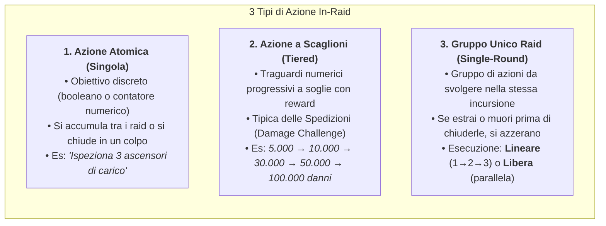

# Architettura delle Azioni In-Raid: Modello Componibile & Linee Guida

Questo documento formalizza l'architettura dei dati, il modello concettuale e le linee guida di visualizzazione per tutte le **azioni da compiere fisicamente durante i raid** (richieste in Quest, Progetti e Spedizioni).

---

## 1. Perimetro & Separazione dei Concetti

Per evitare ambiguità nella modellazione del dominio:
* **Incluso nel perimetro**: compiti, interazioni ed eliminazioni che il giocatore deve compiere fisicamente dentro una mappa di gioco durante una o più incursioni (*in-raid*).
* **Escluso dal perimetro** (gestito da altri sottosistemi dell'engine):
  * Consegne di materiali al rifugio o versamenti di casse (`ItemRequirement`).
  * Requisiti di livello banchi o sblocchi strutturali (`LevelRequirement`).
  * Micro-tracking dello stato delle singole azioni delle quest (le quest mantengono uno stato globale booleano/a tappe; l'obiettivo qui è una **modellazione ed esposizione visiva chiara ed esaustiva** delle richieste di gioco).

---

## 2. I Tre Blocchi Costruttivi Primitivi

Ogni richiesta in-raid si riconduce a una di queste 3 tipologie fondamentali:



### A. Azione Atomica (`AtomicInRaidAction`)
* L'unità minima di interazione.
* Può essere un'azione secca (*«Ispeziona la console nel Lab 1»*) o avere un contatore (*«Elimina 5 droni Pop»*).
* Include metadati di contesto: mappe ammesse (`maps?: string[]`), oggetti da portare nello zaino (`carryItems?: CarryItem[]`) e ricompense opzionali (`rewards?: Reward[]`).

### B. Azione a Scaglioni (`TieredInRaidAction`)
* Scala progressiva di gradini numerici cumulativi.
* Non vincolata a metriche rigide (`metric`): ogni scaglione (`InRaidStep`) definisce la propria soglia/etichetta testuale o numerica e i relativi `rewards?: Reward[]` (sfruttando il catalogo universale degli item di *ARC Benches*).
* Caso d'uso di riferimento: la **Damage Challenge** delle Spedizioni ($5$ livelli progressivi di danno contro macchine ARC o altri giocatori).

### C. Gruppo Unico Raid (`SingleRoundActionGroup`)
* Vincola un insieme di azioni ad essere completate **nella medesima incursione**.
* Supporta due modalità di esecuzione interna:
  * **Lineare (`linear`)**: ordine rigido sequenziale (lo step 2 si attiva solo dopo aver completato lo step 1).
  * **Libera (`parallel`)**: ordine sparso a discrezione del giocatore durante il raid.

---

## 3. Connettori & Meccanismi di Composizione

Nelle Quest dei mercanti e nei contratti complessi, le azioni non sono sempre isolate o puramente sequenziali. La struttura supporta:

### 1. Fasi Cronologiche (`phases: InRaidBlock[]`)
Una sequenza ordinata di blocchi in cui la Fase $N+1$ si sblocca solo al completamento della Fase $N$.
* Esempio: *Fase 1 (Azione atomica preliminare)* $\to$ *Fase 2 (Gruppo di azioni in unico raid)* $\to$ *Fase 3 (Azione finale di estrazione)*.

### 2. Bivi e Scelte Alternative (`choice`)
Permette ramificazioni (bivi logici **OR**) sia alla radice che a metà percorso, con eventuale riconvergenza successiva (pattern *Fork & Join*).
* Esempio: *Inizio comune* $\to$ *Scelta: Percorso A (Buried City) OPPURE Percorso B (Spaceport)* $\to$ *Estrazione finale comune*.

### 3. Quorum Parziale: "Fanne K tra N" (`requiredCount?: number`)
Permette di esprimere gruppi di azioni in cui non è obbligatorio completare ogni voce, ma solo una frazione.
* Esempio: *«Nel corso delle incursioni, completa almeno 2 tra i seguenti 4 compiti»*.

### 4. Vincolo di Sessione Trasversale (`singleRaid?: boolean`)
Un attributo booleano ortogonale presente in `InRaidContext`. Consente di contrassegnare come *"in un unico raid"* sia azioni atomiche singole (es. *«Infliggi 2.000 danni in un singolo raid»*), sia gruppi o blocchi a scaglioni, senza dover creare artificiosi wrapper a singolo elemento.

---

## 4. Modello Dati TypeScript Puro (per `src/engine/`)

Questo modello è a **zero dipendenze da React, Zustand o Tailwind**, pronto per essere coperto da unit test e migrato 1:1 nel nuovo repository Next.js:

```ts
import type { Reward } from './items';

/**
 * Contesto geografico, logistico e di sfida di un'azione in-raid.
 */
export type InRaidContext = {
  /** Array di ID delle mappe in cui l'azione è valida (assente o vuoto = qualsiasi mappa) */
  maps?: string[];
  /** Oggetti necessari nello zaino al momento dell'azione (es. badge, chiavi, batterie) */
  carryItems?: Array<{ itemId: string; quantity: number }>;
  /** Se true, l'obiettivo si azzera se non completato prima dell'estrazione o della morte */
  singleRaid?: boolean;
  /** Modificatori o condizioni speciali di ingaggio (es. "solo di notte", "senza farsi rilevare") */
  conditions?: string[];
};

/**
 * 1. Azione Atomica (Singola)
 */
export type AtomicInRaidAction = InRaidContext & {
  id: string;
  label: string;
  translations?: Record<string, { label: string }>;
  /** Quante volte va compiuta (default: 1) */
  targetCount?: number;
  rewards?: Reward[];
};

/**
 * 2. Step di un'Azione a Scaglioni
 */
export type InRaidStep = InRaidContext & {
  id: string;
  label: string;
  translations?: Record<string, { label: string }>;
  rewards?: Reward[];
};

/**
 * Azione a Scaglioni (Generica e progressiva)
 */
export type TieredInRaidAction = InRaidContext & {
  id: string;
  label: string;
  translations?: Record<string, { label: string }>;
  steps: InRaidStep[];
};

/**
 * 3. Gruppo di Azioni In-Raid
 */
export type InRaidActionGroup = InRaidContext & {
  id: string;
  label?: string;
  executionMode: 'linear' | 'parallel';
  /** Se valorizzato, bastano K azioni su N (Quorum); se omesso servono tutte */
  requiredCount?: number;
  actions: AtomicInRaidAction[];
};

/**
 * 4. Blocco Esecutivo Polimorfico (Componente di Fase)
 */
export type InRaidBlock =
  | { kind: 'atomic'; action: AtomicInRaidAction }
  | { kind: 'tiered'; challenge: TieredInRaidAction }
  | { kind: 'group'; group: InRaidActionGroup }
  | {
      kind: 'choice';
      id: string;
      label?: string; // Es. "Scegli l'infiltrazione o l'assalto"
      options: Array<{
        optionId: string;
        label: string; // Es. "Ramo Buried City" vs "Ramo Spaceport"
        block: InRaidBlock;
      }>;
    };

/**
 * 5. Sequenza Completa della Quest o del Progetto
 */
export type QuestInRaidSequence = {
  /** Sequenza temporale ordinata di fasi esecutive */
  phases: InRaidBlock[];
};
```

---

## 5. Decisione Architetturale: Value Object vs Entità Autonoma

### Perché NON creare un'entità con tabella autonoma
1. **Assenza di riuso tra quest**: le azioni in-raid sono composte da descrizioni, luoghi e condizioni specifiche di quella precisa missione. Non vengono riutilizzate trasversalmente tra decine di quest diverse.
2. **Ciclo di vita accoppiato**: se una quest viene rimossa o modificata, le sue azioni non devono persistere come entità orfane.
3. **Persistenza ideale (Postgres / JSONB)**:
   Nel futuro portale Next.js con database relazionale (Supabase o Neon), la struttura è memorizzata nativamente come documento incorporato:
   ```sql
   ALTER TABLE quests ADD COLUMN in_raid_plan jsonb NOT NULL DEFAULT '{"phases": []}'::jsonb;
   ```
   Questa scelta garantisce letture istantanee (senza `JOIN` ricorsivi tra tabelle di fasi, blocchi e step), aggiornamenti atomici e validazione applicativa rigorosa tramite Zod.

---

## 6. Esperienza di Sviluppo: Action Studio Previewer (No Tree Builder)

Costruire un form HTML ricorsivo (con bottoni per aggiungere blocchi, scelte e sotto-azioni annidate) richiederebbe centinaia di righe di codice fragile e risulterebbe frustrante e lento da usare.

### L'Approccio Consigliato: "Action Studio Sandbox"
Nella sezione Dev (o in un componente isolato dedicato), l'interfaccia si struttura con:
1. **Pannello Editor / Dati (Sinistra)**:
   * Selettore di **Preset Predefiniti** (*«Bivio per Mappa»*, *«Incursione Singola 3 Step»*, *«Damage Challenge a Scaglioni»*, *«Quorum 2 su 4»*).
   * Editor di testo JSON/YAML assistito con validazione Zod in tempo reale.
2. **Pannello Live Rendering (Destra)**:
   * Visualizzazione in tempo reale del componente UI reale, identico a quello che vedrà l'utente finale nel dettaglio della quest o del progetto.
   * Permette di collaudare il rendering responsive, i colori delle mappe, le pill di avviso e i connettori visivi senza toccare il database.

---

## 7. Linee Guida di Rendering UI

Per rendere la complessità delle azioni intuitiva da smartphone:

1. **Badge "In un unico raid"**:
   * Icona chiara (es. cronometro/incursione) con bordo ambra o accento visivo, per avvertire il giocatore che gli obiettivi non sono cumulabili tra round diversi.
2. **Indicatori di Sequenza (Lineare vs Libera)**:
   * Sequenziale: numeri ordinali evidenti (`1`, `2`, `3`) con connettori verticali a linea continua.
   * Libera: checkmark o punti elenco semplici con badge di riepilogo avanzamento (es. `2/4 completate`).
3. **Bivi e Scelte Alternative (`choice`)**:
   * Contenitore a schede affiancate (o toggle segmentato su mobile) con il separatore testuale **«OPPURE»** ben visibile tra le opzioni.
4. **Chips di Contesto (`ActionContextChips`)**:
   * Badge compatti con colore dedicato per le mappe (es. Buried City in ciano, Spaceport in arancio).
   * Badge con icona valigetta/chiave per gli oggetti da trasportare nello zaino (`carryItems`).
