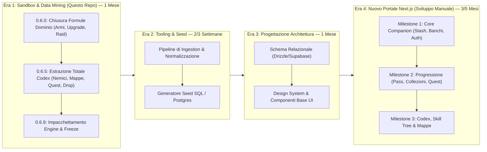

# Strategia di Transizione: dal Prototipo al Portale Definitivo

Questo documento formalizza la decisione architetturale, la suddivisione in Ere e la roadmap per il passaggio dell'applicazione da sandbox/client-SPA (Vite + Tailwind + localStorage) al prodotto finale su nuovo repository (Next.js + Database Serverless + Base UI scritta a mano).

---

## 1. Ruolo del Progetto Attuale (Data Mining, Prototipo & Engine)

Il repository corrente `arc-benches` funge da **Sandbox di ricerca, Data Mining e validazione delle formule**:
* Validare il modello matematico di aggregazione dei costi e calcolo del fabbisogno materiali.
* Estrarre e normalizzare da fonti upstream (MetaForge, RaidTheory, ARC Tracker, Wiki) l'intero dataset di gioco: oggetti, varianti d'arma, ricette, skill tree, 123 quest, nemici ARC (Codex), mappe e commercianti.
* Creare l'**Engine matematico puro** (TypeScript a zero dipendenze UI) coperto da unit test automatizzati.
* Raggiungere il **Feature & Data Freeze** (versione `0.6.9`) come archivio privato di benchmark.

---

## 2. Decisione: Nuovo Repository & Sviluppo Manuale Umano

Al termine della Fase di Data Mining (`v0.6.9`), **non si effettuerà un refactoring in-place**, ma si procederà all'inizializzazione di un **nuovo repository pulito**:

1. **Commit History Pulita & Autentica:**
   * La repository pubblica finale partirà con una cronologia di commit ordinata, professionale e priva delle tracce e dell'iper-velocità tipiche del vibe coding.
   * Nessun file di configurazione per agenti (`AGENTS.md`, `.agents/`, prompt rules).
2. **Sviluppo Frontend Manuale & Base UI:**
   * Abbandono della generazione massiva di UI con Tailwind inline.
   * Adozione mirata di `@base-ui-components/react` (headless, accessibile) con design system proprietario scritto a mano in modo snello e manutenibile.
3. **Architettura Next.js Nativa (Server Components):**
   * Pagine statiche, cataloghi e schede oggetto renderizzati sul server come **React Server Components (RSC)** a zero JS client.
   * Client Components limitati strettamente alle isole di interattività (contatori Stash, slider, dialoghi modali Base UI, visualizzatore Skill Tree).
4. **Persistenza Cloud & Sync Offline-First:**
   * Passaggio da `localStorage` / `safeLS` a un database relazionale Postgres serverless (Supabase o Neon con Drizzle ORM) e autenticazione dedicata.

---

## 3. Le 4 Ere di Sviluppo e Tempistiche

### Dettaglio delle Fasi:

* **Era 1 — Sandbox & Data Mining (1 mese, su questo repository):**
  * Chiusura formule di calcolo mancanti (armi amplificate, upgrade `I→IV`, riparazione).
  * Estrazione del Codex nemici ARC con loot table e statistiche.
  * Normalizzazione POI mappe e consolidamento quest.
  * Isolamento dell'Engine matematico puro e test al 100%.
  * Privatizzazione/archiviazione di `arc-benches`.
* **Era 2 — Tooling & Seed (2–3 settimane):**
  * Script di migrazione da JSON a tabelle relazionali SQL.
  * Pipeline di verifica integrità e script per recepire patch upstream di *ARC Raiders*.
* **Era 3 — Progettazione Architettura & Design (1 mese):**
  * Stesura dello schema relazionale Postgres con chiavi e vincoli (Drizzle ORM).
  * Progettazione UX/UI, gerarchia mobile-first e layout RSC.
  * Setup token CSS semantici e integrazione componenti headless Base UI.
* **Era 4 — Realizzazione Manuale del Nuovo Portale (3–5 mesi, a milestone progressive):**
  * *Milestone 1 (Settimana 1–8)*: Shell app, Auth, Stash aggregato e Banchi del rifugio.
  * *Milestone 2 (Settimana 9–14)*: Reward Pass, Collezioni (Blueprint/Design/Stencil), Quest Tracker.
  * *Milestone 3 (Settimana 15–20)*: Skill Tree vettoriale, Codex nemici e Mappe interattive.

---

## 4. Matrice di Confine: Cosa FARE e NON FARE in questo Repo

Per evitare sprechi di tempo e sovra-ingegnerizzazione su un codice destinato ad essere congelato:

| Ambito | ✅ Cosa FARE su `arc-benches` (Fase 1) | ❌ Cosa NON FARE (Escluso / Rimandato) |
| :--- | :--- | :--- |
| **Formule & Logica** | • Logica potenziamento armi `I→IV`, riparazione, amplificazione (#92, #113). • Regole matematiche Spedizioni e reset (#146). • Logica sblocco sequenziale quest. | • Animazioni di level-up. • Riprogettazione visiva della pagina Spedizioni. |
| **Codex Nemici ARC** | • Script `fetch-enemies.mjs`: estrazione di tutti gli ARC (Snitch, Bastion, Sentinel, Queen, ecc.). • Dati completi: minaccia, parti distruggibili, debolezze, loot table, lore. • File: `src/data/codex-enemies.json`. | • Interfaccia 3D del bestiario o schede grafiche animate. |
| **Mappe & POI** | • Script `fetch-maps.mjs`: estrazione metadati mappe (Calma, Buried City, Spaceport), zone estrazione, bunker a chiave, stazioni rifornimento, zone loot. • File: `src/data/maps.json` e POI normalizzati. | • Canvas interattivo complesso o navigazione GPS in-game. • Integrazione Leaflet complessa in questo repo. |
| **Quest & Mercanti** | • Consolidamento grafo 123 quest (mandanti, tappe, ricompense). • Limiti statici giornalieri commercianti (`traders.json`). | • Vista ad albero interattivo stile Miro per le quest. • Countdown o notifiche push per il reset dei mercanti. |
| **Engine & Tooling** | • Isolamento formule pure in `src/engine/` a **zero dipendenze da React o Zustand**. • Unit test Vitest completi sulle formule. | • Adozione di Base UI in questo repo. • Refactor di componenti UI esistenti. • Pagine accessorie: Bacheca Trofei (#70), Guardaroba (#131), Dashboard (#56). |

---

## 5. Matrice di Travaso al Nuovo Repository

| Asset / Modulo | Destinazione nel Nuovo Repo | Note |
| :--- | :--- | :--- |
| **`src/engine/` (Formule pure, selettori, craft)** | `packages/engine/` o `lib/engine/` | **Copia 1:1** (pure TypeScript functions, già coperte da test). |
| **Pipeline dati (`scripts/fetch-*.mjs`)** | `scripts/` o `packages/ingestion/` | **Copia & Adattamento** per caricare direttamente nel DB. |
| **Dataset JSON (`items.json`, `codex-*.json`, ecc.)** | Script di Seed Postgres | Utilizzati per generare il seed iniziale del database. |
| **Specifiche di dominio (`docs/specs/`)** | Documentazione del nuovo repo | Fonte di verità funzionale dei requisiti di gioco. |
| **Componenti JSX & Tailwind (`src/components/`)** | 🗑️ **Scartati** | Riscrizione manuale con Server Components + Base UI. |
| **Persistenza `safeLS` / LocalStorage** | 🔄 **Sostituita** | Database Postgres (Supabase/Neon) con cache locale. |
